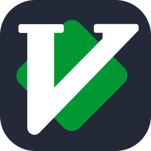

<!-- Visual sources: https://github.com/kyechan99/capsule-render (MIT, adapted wave composition), https://github.com/tandpfun/skill-icons (MIT), https://github.com/stats-organization/github-stats-extended (MIT, language card). License copies are in assets/community/. -->

  <picture>
    <source media="(prefers-color-scheme: dark)" srcset="assets/community/header.svg">
    <source media="(prefers-color-scheme: light)" srcset="assets/community/header-light.svg">
    
  </picture>

  TOOLS &amp; FRAMEWORKS 
  
  
  
  
  
  

  LANGUAGES 
  
  
  

  <picture>
    <source media="(prefers-color-scheme: dark)" srcset="assets/community/languages-dark.svg">
    <source media="(prefers-color-scheme: light)" srcset="assets/community/languages-light.svg">
    
  </picture>

